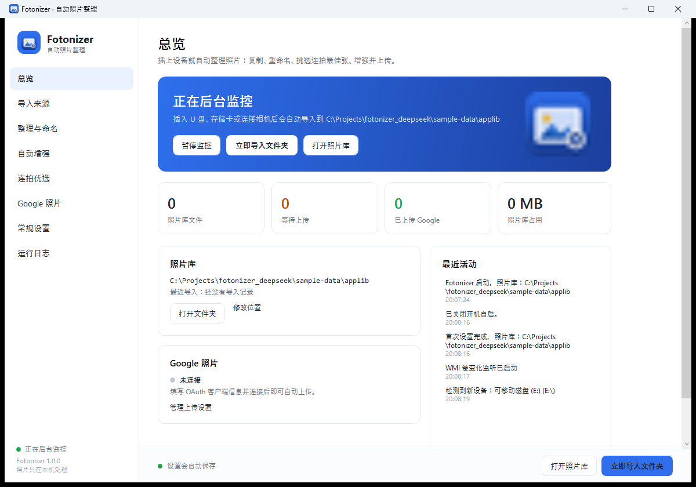
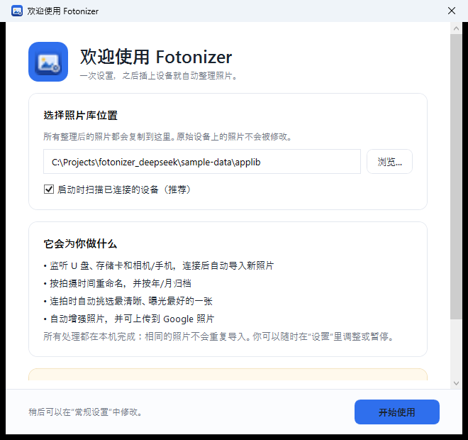
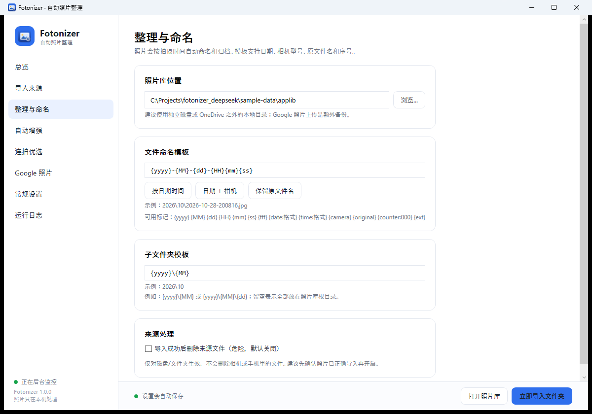
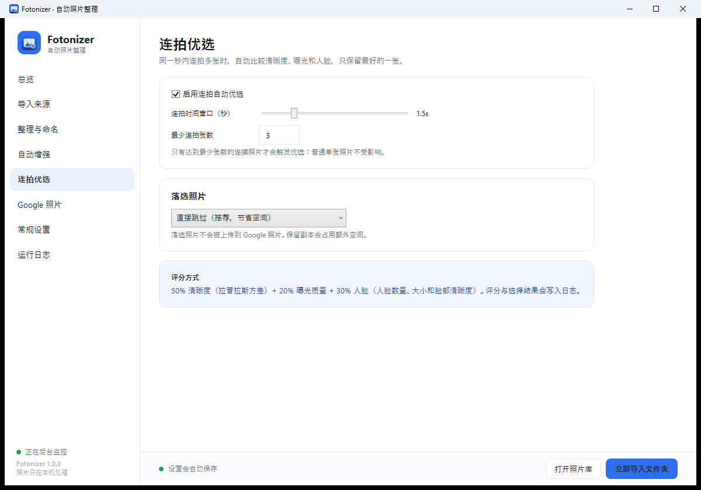
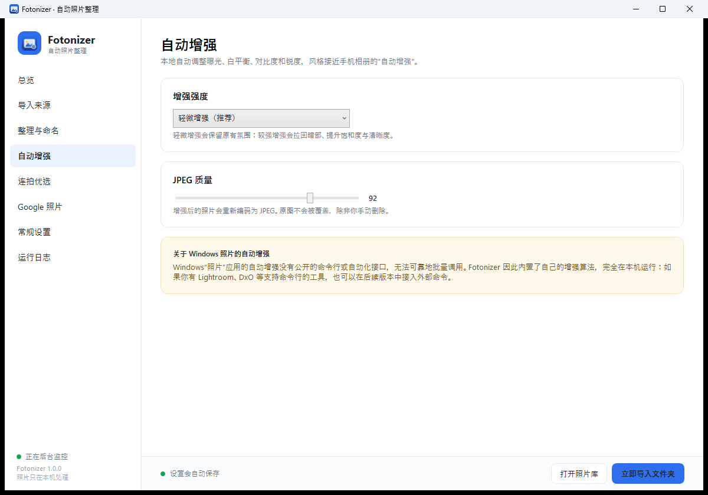
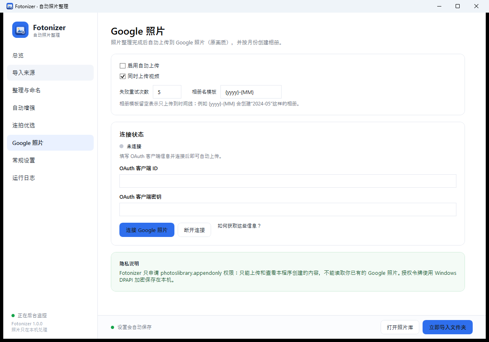
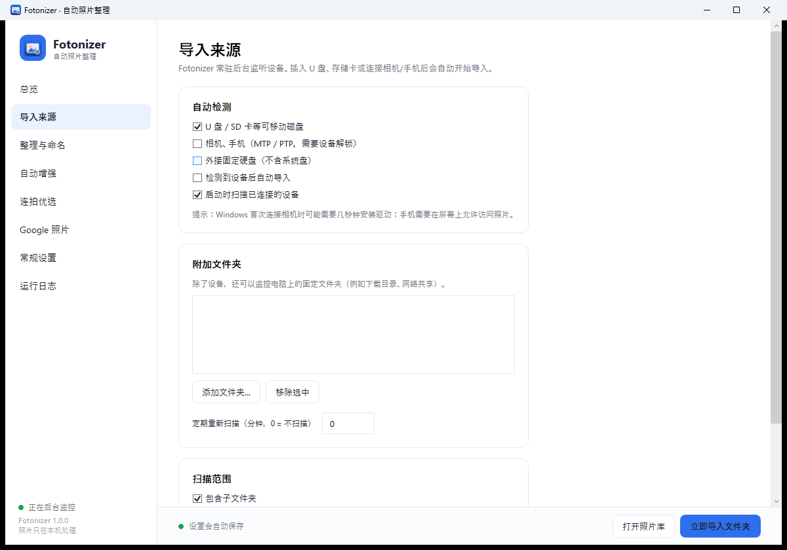
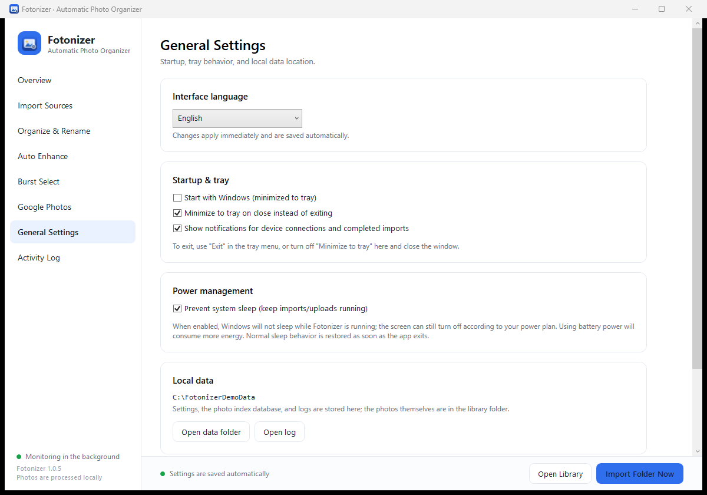
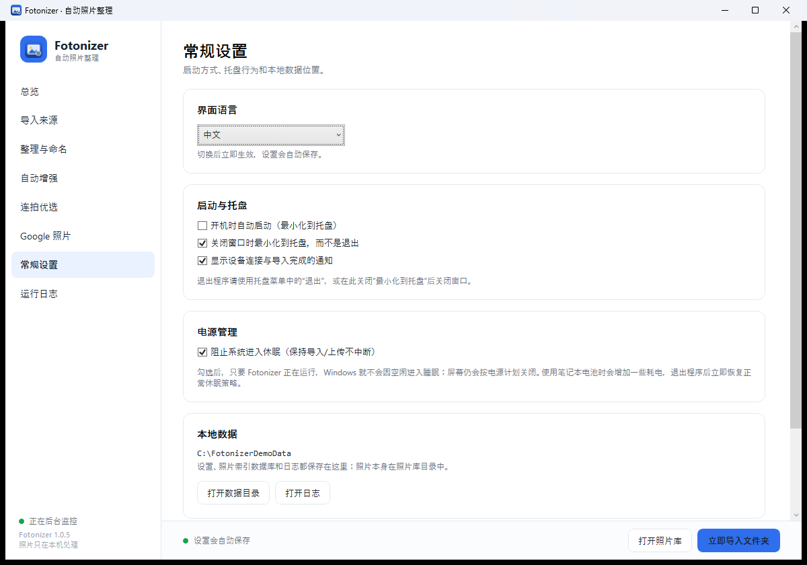
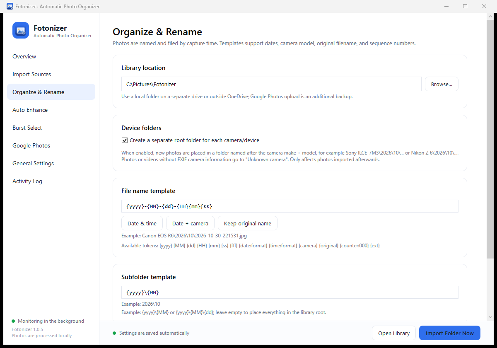

# Fotonizer · 自动照片整理

[](https://github.com/ningzhibin/fotonizer/releases/latest)
[](LICENSE)
[](#快速开始)

[English](README.en.md) | 中文

一个常驻 Windows 托盘的照片管家：插上 U 盘、存储卡或相机后自动导入，按拍摄时间重命名归档、去重、挑选连拍中最好的一张、自动增强，并备份到 Google 照片。

界面使用 WPF（.NET 8），照片处理全部在本机完成，不上传原图到除 Google 照片以外的任何地方。



## 目录

- [功能](#功能)
- [快速开始](#快速开始)
- [第一次使用](#第一次使用)
- [命名与目录模板](#命名与目录模板)
- [连拍优选](#连拍优选)
- [自动增强](#自动增强)
- [Google 照片上传](#google-照片上传)
- [设备支持](#设备支持)
- [数据、隐私与卸载](#数据隐私与卸载)
- [命令行工具](#命令行工具)
- [从源码构建](#从源码构建)
- [项目结构](#项目结构)
- [常见问题](#常见问题)
- [已知限制](#已知限制)

## 功能

- **设备监听**：常驻托盘，监听可移动磁盘（U 盘 / SD 卡 / 读卡器）以及通过 MTP/PTP 连接的相机和手机。插入后自动开始导入，无需手动操作。
- **自动复制 + 去重**：按 SHA-256 与快速指纹双重去重，同一张照片重复插卡也不会重复导入。
- **自动重命名与归档**：默认按拍摄时间命名为 `2024-05-01-101500.jpg`，按 `年\月` 归档；模板可自定义。
- **连拍优选**：同一秒内连拍多张时，按清晰度、曝光、人脸数量和脸部清晰度自动挑选最好的一张，其余跳过或保留到 `_Burst` 子目录。
- **自动增强**：本地实现自动色阶、灰世界白平衡、中间调 Gamma、饱和度与锐化，风格接近手机相册的“自动增强”。
- **Google 照片备份**：通过官方 Photos Library API 上传，按月份自动创建相册；令牌用 Windows DPAPI 加密保存。
- **简单 GUI**：所有配置都有中文 / English 界面，修改自动保存；支持开机自启、托盘菜单、通知和日志查看。
- **可暂停**：随时暂停/恢复监控；手动“立即导入”任意文件夹。
- **CLI**：`fotonizer-cli` 可在无界面环境下执行同一套导入流水线，方便自动化和排查。

## 快速开始

### 方式 A：使用打包好的程序（推荐）

1. 从 [GitHub Releases](https://github.com/ningzhibin/fotonizer/releases/latest) 下载 `Fotonizer-win-x64-1.0.5.zip`。
2. 解压到任意目录（不要直接在压缩包里运行）。
3. 双击 `Fotonizer.exe`。
4. 首次启动会显示欢迎页：选择照片库目录，点击“开始使用”。
5. 之后插入 U 盘 / 存储卡，或连接相机即可。程序会缩到系统托盘继续工作。

程序是 **self-contained** 发布，目标机器不需要预装 .NET。要求 Windows 10 2004（19041）或更高版本、x64。

> 程序没有代码签名，首次运行时 Windows SmartScreen 可能提示“Windows 已保护你的电脑”；点击“更多信息 → 仍要运行”即可。

> 如果你在开发环境里直接运行 `dotnet run`，需要 .NET 8 SDK；成品 `publish` 目录不受此限制。

### 方式 B：从源码构建

```powershell
dotnet restore
dotnet build -c Release
dotnet test
dotnet publish src/Fotonizer.App/Fotonizer.App.csproj -c Release -r win-x64 --self-contained true -o publish/Fotonizer-win-x64
```

## 第一次使用

首次启动的欢迎页会要求选择照片库位置：



- 默认位置是“图片\Fotonizer”（如果系统把“图片”重定向到 OneDrive，则会是 OneDrive 下的路径）。建议改成独立磁盘上的目录，避免云同步与大批量写入互相干扰。
- 第一次连接设备时，Fotonizer 会导入设备上**所有尚未导入过**的照片，因此可能耗时较长；之后只处理新增照片。
- 在完成首次设置前，程序不会监听设备，避免误导入。

导入完成后，照片按模板放到照片库，原始设备上的文件默认**不会**被修改或删除。

## 命名与目录模板

默认：

- 文件名：`{yyyy}-{MM}-{dd}-{HH}{mm}{ss}` → `2024-05-01-101500.jpg`
- 子目录：`{yyyy}\{MM}` → `2024\05\`



支持的标记（区分大小写：`{MM}` 是月份，`{mm}` 是分钟）：

| 标记 | 含义 | 示例 |
| --- | --- | --- |
| `{yyyy}` `{yy}` | 四位/两位年 | `2024` / `24` |
| `{MM}` | 月（01–12） | `05` |
| `{dd}` | 日 | `01` |
| `{HH}` | 24 小时制小时 | `13` |
| `{mm}` | 分钟 | `15` |
| `{ss}` `{fff}` | 秒 / 毫秒 | `00` / `123` |
| `{date:格式}` | 自定义 .NET 日期格式 | `{date:yyyy-MM-dd}` |
| `{time:格式}` | 自定义时间格式 | `{time:HHmmss}` |
| `{datetime:格式}` | 日期 + 时间 | `{datetime:yyyyMMdd_HHmmss}` |
| `{camera}` | 相机型号（没有则为空） | `EOS R6` |
| `{make}` `{model}` | 厂商 / 型号 | `Canon` / `EOS R6` |
| `{original}` | 原文件名（不含扩展名） | `IMG_1234` |
| `{counter}` / `{counter:0000}` | 本次导入的序号 | `007` / `0007` |
| `{ext}` | 输出扩展名（含 `{ext}` 时不再自动追加） | `jpg` |

示例：

- 日期 + 相机：`{yyyy}-{MM}-{dd}-{HH}{mm}{ss}-{camera}`
- 保留原文件名：`{original}`（仍会自动去重、编号）
- 按天归档：子目录 `{yyyy}\{MM}\{dd}`

文件名中的非法字符会被自动清理；同名文件会追加 `-1`、`-2`。

## 连拍优选



- 分组条件：拍摄时间间隔 ≤ 时间窗口（默认 1.5 秒）、相机型号相同、组内数量 ≥ 最少张数（默认 3 张）。
- 评分：**50% 清晰度**（拉普拉斯方差）+ **20% 曝光质量** + **30% 人脸**（人脸数量、人脸面积、脸部区域清晰度）。没有检测到人脸时，改为 65% 清晰度 + 35% 曝光。
- 只导入得分最高的那一张；其余默认直接跳过，也可以在设置中保留到 `_Burst` 子目录。
- 被跳过的照片会记入“已处理”索引，下次再扫描同一张卡不会逐张导入。
- 评分与选择结果写入日志（例如“连拍组 20240501-101500: 共 5 张，选中 BURST_01.JPG（清晰度 204，曝光 0.80）”）。

## 自动增强



Windows“照片”应用的自动增强**没有公开的自动化接口**，无法可靠批量调用（也没有命令行参数）。因此 Fotonizer 内置了本地增强算法：

1. 采样亮度直方图，按 0.5% / 99.5% 分位拉伸黑白场；
2. 灰世界白平衡，增益限制在安全范围内；
3. 中间调 Gamma 校正，目标平均亮度约 0.48；
4. 饱和度提升（类似 vibrance）；
5. 亮度通道 USM 锐化。

增强强度分“轻微 / 较强”，输出高质量 JPEG（默认 92）。只处理 JPG / HEIC / TIFF；PNG、视频、RAW 只复制不增强。像素不旋转，EXIF 方向标记会原样保留，因此在任何看图软件里方向仍然正确。

> HEIC 解码依赖 Windows 的“HEIF 图像扩展”。如果增强 HEIC 失败，程序会记录警告并保留原文件，不会丢照片。

## Google 照片上传



上传使用 Google Photos Library API，只申请 `photoslibrary.appendonly` 权限：

- 只能上传照片、创建相册、查看本程序自己上传的内容；
- **不能**读取或删除你已有的 Google 照片；
- 刷新令牌用 Windows DPAPI（当前用户）加密保存在 `%APPDATA%\Fotonizer\secrets.bin`。

详细的开通步骤（创建 Google Cloud 项目、启用 API、OAuth 同意屏幕、桌面客户端 ID）见 **[docs/google-photos-setup.md](docs/google-photos-setup.md)**。

配置完成后：

1. 勾选“启用自动上传”；
2. 填入 OAuth 客户端 ID / 密钥；
3. 点击“连接 Google 照片”，在浏览器里完成授权；
4. 之后新导入的照片会自动上传；失败的会按设置重试（默认 5 次）。

相册名模板默认 `{yyyy}-{MM}`，会为每个月创建一个相册；留空则只上传到时间线。

> **API 现状（2025 年起）**：Google Photos Library API 只允许应用访问自己创建的内容。因此 Fotonizer 无法检查你 Google 照片里已有的照片，也无法做双向同步；这是 Google 的平台限制，不是程序缺陷。

## 设备支持



| 设备 | 支持情况 |
| --- | --- |
| U 盘、SD 卡、读卡器、外接硬盘 | ✅ WMI 卷事件 + 轮询，插入即导入 |
| Android 手机（MTP） | ✅ 通过 Windows WPD 导入；手机需解锁并允许访问照片 |
| iPhone / iPad | ✅ 走 Windows MTP（照片格式可能是 HEIC）；需在手机上点“信任” |
| 数码相机（PTP/MTP） | ✅ 支持 DCIM/Pictures 等常见目录；部分相机需要先在菜单里选择“MTP/PTP”模式 |
| 网络共享、固定文件夹 | ✅ 可在“附加文件夹”里添加，支持定期重新扫描 |
| RAW（CR2/NEF/ARW/DNG…） | ⚠️ 只复制、不增强、不参与连拍评分 |

默认会跳过隐藏目录、系统目录、回收站、照片库自身，避免把已整理的照片再次导入。

## 数据、隐私与卸载

| 内容 | 位置 |
| --- | --- |
| 照片库 | 首次设置时选择的目录 |
| 设置 | `%APPDATA%\Fotonizer\settings.json` |
| Google 凭据（DPAPI 加密） | `%APPDATA%\Fotonizer\secrets.bin` |
| 照片索引 / 上传队列 | `%LOCALAPPDATA%\Fotonizer\library.db` |
| 日志 | `%LOCALAPPDATA%\Fotonizer\logs\` |

便携模式：使用 `Fotonizer.exe --data D:\FotonizerData` 可以把设置、数据库、日志和凭据放到指定目录（凭据仍受当前 Windows 用户 DPAPI 保护）。

- 照片处理完全在本机进行；除主动启用的 Google 照片上传外，不发送任何照片或元数据。
- 程序不申请管理员权限，开机自启用的是当前用户的 `HKCU\...\Run`。
- 卸载：退出程序，删除程序目录、上面两个数据目录，以及照片库目录即可；开机自启项可在“常规设置”里关闭。

## 命令行工具

`fotonizer-cli` 与 GUI 共用同一条导入流水线，适合自动化或排查问题。它面向源码/开发环境，需要 .NET 8；打包的 GUI 成品不包含 CLI。

```powershell
# 列出当前磁盘与 MTP 设备
fotonizer-cli devices

# 扫描某个目录（只列出候选文件，不导入）
fotonizer-cli scan --source E:\DCIM

# 查看一张照片的 EXIF 解析结果
fotonizer-cli inspect --file E:\DCIM\100CANON\IMG_0001.JPG

# 导入（使用独立数据目录，不影响 GUI 配置）
fotonizer-cli import --source E:\DCIM --dest D:\Photos --data C:\Temp\fotonizer-data

# 导入并关闭增强 / 保留连拍落选
fotonizer-cli import --source E:\DCIM --dest D:\Photos --no-enhance --keep-burst
```

可用参数：`--enhance off|subtle|strong`、`--no-enhance`、`--no-burst`、`--keep-burst`、`--no-videos`、`--delete-source`。

## 从源码构建

环境：Windows 10 2004+、x64、[.NET 8 SDK](https://dotnet.microsoft.com/download/dotnet/8.0)。

```powershell
dotnet restore Fotonizer.sln
dotnet build Fotonizer.sln -c Release
dotnet test tests/Fotonizer.Tests/Fotonizer.Tests.csproj -c Release
```

运行：

```powershell
dotnet run --project src/Fotonizer.App
dotnet run --project src/Fotonizer.Cli -- devices
```

生成测试照片（需要 Python + Pillow）：

```powershell
python tools/make_sample_photos.py
dotnet run --project src/Fotonizer.Cli -- import --source sample-data/source --dest sample-data/out --data sample-data/work
```

打包：

```powershell
dotnet publish src/Fotonizer.App/Fotonizer.App.csproj -c Release -r win-x64 --self-contained true -o publish/Fotonizer-win-x64
Compress-Archive -Path publish/Fotonizer-win-x64/* -DestinationPath publish/Fotonizer-win-x64.zip -Force
```

也可以直接运行仓库根目录的 `build.ps1`（会依次 restore / build / test / publish / 压缩）：

```powershell
.\build.ps1
.\build.ps1 -DotnetExe "C:\Program Files\dotnet\dotnet.exe" -SkipTests
```

## 项目结构

```
src/
  Fotonizer.Core/          所有业务逻辑（无 UI 依赖，可测试）
    Devices/               U 盘 / MTP 设备检测
    Import/                扫描、去重、命名、SQLite 索引、导入流水线
    Media/                 EXIF、WIC 解码、评分、连拍优选、增强
    Upload/                Google OAuth + Photos API + 上传队列
    Settings/              设置、DPAPI 凭据、开机自启
  Fotonizer.App/           WPF 界面、托盘、首次设置
  Fotonizer.Cli/           命令行工具
tests/
  Fotonizer.Tests/         xUnit 单元 / 集成测试
tools/
  make_sample_photos.py    生成带 EXIF 的测试照片
docs/
  google-photos-setup.md   Google 照片开通指南
```

数据流：

```
设备插入
  → DeviceMonitor（WMI 事件 + 轮询）
  → SourceScanner / PortableDeviceImporter
  → 快速指纹去重
  → EXIF 拍摄时间
  → 连拍分组 + 评分（WIC 解码 + 人脸检测）
  → 复制 → 增强 → 重命名 → 写入 library.db
  → UploadService（可选）→ Google Photos
```

## 常见问题

**插上 U 盘没有反应？**
确认“导入来源 → 自动检测 → U 盘 / 可移动磁盘”已勾选，且“检测到设备后自动导入”已勾选。Windows 服务 `Winmgmt`（WMI）被禁用时事件监听会失效，程序会自动退回轮询。

**相机/手机连上但没导入？**
手机需要解锁并在屏幕上允许访问照片；iPhone 需要点“信任”。部分相机默认是“仅充电”或 PTP 模式，需要在相机菜单里改成 MTP/PTP。

**为什么第一次导入了很多旧照片？**
去重索引是空的，首次会复制所有尚未导入过的照片。之后不会再重复。

**照片会重复吗？**
按 SHA-256 内容 + 快速指纹去重；连拍落选照片也会记录，不会下次逐张导入。

**自动增强和 Windows 照片的效果一样吗？**
不一样。Windows 照片没有公开 API，Fotonizer 使用自己的算法，默认“轻微增强”比较保守；可以在“自动增强”里关闭或调强。

**Google 上传失败？**
按提示检查：API 是否启用、OAuth 客户端类型是否为“桌面应用”、客户端 ID/密钥是否匹配、账号是否在“测试用户”里、是否完成授权。日志会记录 Google 返回的具体错误。

**托盘图标不见了？**
Windows 11 可能把新图标收进“隐藏的图标”区域，可在任务栏设置里固定。

**支持 ARM64 / Windows 7 吗？**
当前只提供 win-x64、Windows 10 2004+。ARM64 可以在源码里改用 `-r win-arm64` 发布（依赖 .NET 8 ARM64 桌面运行时）。

## 界面语言



在 **常规设置 → 界面语言** 中选择 `中文` 或 `English`，切换后立即生效并自动保存，下次启动继续使用上次的语言。

- 菜单、设置页、首次使用向导、Google 授权指南、托盘菜单、通知和状态提示都已提供英文；
- 运行日志的常见消息和级别会尽量翻译，底层异常/详细错误仍保留原始文本；
- 语言只影响界面，不改变照片目录、文件名或 Google 相册的命名规则。

## 电源管理



在“常规设置 → 电源管理”勾选 **“阻止系统进入休眠”** 后，只要 Fotonizer 在运行，Windows 就不会因为空闲进入睡眠，适合长时间导入或上传大视频。它使用 Windows 原生 Power Request，只阻止系统休眠，**不会让屏幕常亮**；退出程序后自动恢复系统原有休眠策略。

使用笔记本电池时会增加一些耗电；不需要时可以随时取消勾选。

## 已知限制

- Windows 专用（WPF + WIC + WPD + DPAPI），不支持 macOS/Linux。
- 自动增强不处理 RAW，也不会做人脸识别、按人物分相册。
- Google Photos API 只能追加，不能读取已有照片库，无法做双向同步或云端去重。
- MTP 设备上的文件不会被删除（“导入后删除来源”只对磁盘/文件夹生效）。
- 上传速度受 Google API 配额限制（程序内置节流与 429 重试）。
- 连拍评分基于图像统计，不是审美判断；可通过时间窗口和最少张数调整触发范围。
- 一个 Windows 用户同时只运行一个实例。

## 按设备建立目录



在“整理与命名 → 设备目录”中勾选 **“按相机/设备建立独立根目录”** 后，新导入的照片会先按 EXIF 里的厂商和型号建立根目录，再按日期归档：

```text
照片库\
  Canon EOS R6\
    2026\10\2026-10-11-121044.jpg
  Sony ILCE-7M3\
    2026\10\2026-10-11-121125.jpg
  NIKON Z 6\
    2026\09\2026-09-07-082942.jpg
```

- 目录名由 `厂商 + 型号` 生成，自动去掉 `CORPORATION` 等后缀，并清理非法字符；
- 没有 EXIF 相机信息的照片/视频会进入 `未识别相机`；
- 只影响**之后新导入**的照片，不会移动照片库里已有的文件；
- 同一型号的两台机身会共用一个目录（EXIF 通常没有区分它们的序列号）。

## 更新记录

### 1.0.5

- **新增英文界面**：常规设置中可在 `中文` / `English` 之间即时切换，选择会保存并在下次启动时恢复。
- 英文覆盖主窗口、设置页、首次使用向导、Google 授权指南、托盘菜单、通知和状态提示。
- 运行日志的级别和常见消息提供英文显示；底层异常详情保留原始文本。
- 新增语言设置测试，自动化测试总数 37。

### 1.0.4

- 整理与命名新增 **“按相机/设备建立独立根目录”** 选项：按 EXIF 厂商 + 型号分目录，例如 `Sony ILCE-7M3\2026\10\...`、`Nikon Z 6\...`。
- 没有 EXIF 信息的照片/视频归入 `未识别相机`；只影响新导入的照片。
- 文件命名预览会同步显示设备根目录。
- 新增设备目录命名与导入路径测试，自动化测试总数 31。

### 1.0.3

- 常规设置新增 **“阻止系统进入休眠”** 选项：勾选后，只要 Fotonizer 正在运行，Windows 就不会因空闲进入睡眠，避免长时间导入/上传被中断。
- 使用 Windows 原生 Power Request（`PowerCreateRequest` / `PowerSetRequest`），只阻止系统休眠，**不会让屏幕常亮**；退出程序后自动恢复正常休眠策略。
- 使用电池时会增加一些耗电，可随时取消勾选。
- 新增休眠阻止测试，自动化测试总数 26。

### 1.0.2

- 修复大视频上传超过 5 分钟后上传线程停止的问题：旧版会把 `HttpClient` 超时误判为程序退出，导致整个上传队列停住，界面上一直显示“等待上传”。
- 上传请求不再使用 5 分钟总超时（按文件最长 12 小时）；获取令牌、创建相册、`batchCreate` 仍使用 2 分钟超时。
- 超时/网络异常按失败重试，不再终止上传循环；上传状态会显示在总览页。
- 待上传队列优先上传小文件，避免 GB 级视频卡住后面的照片。
- 新增上传超时恢复测试，自动化测试总数 25。

### 1.0.1

- 修复 Google 授权完成后偶发的 `Cannot access a disposed object. Object name: 'System.Net.HttpListener'` 后台警告：本地 OAuth 回调不再使用 `HttpListener`，改为自建的回环 TCP HTTP 回调服务器，连接生命周期完全可控。
- 新增回调服务器测试（含 favicon 干扰场景），自动化测试总数 23。
- 版本号更新为 1.0.1。

> 升级方法：先从托盘菜单“退出”旧版 Fotonizer，再用新版文件覆盖旧目录；设置和 Google 授权保存在 `%APPDATA%` / `%LOCALAPPDATA%`，不会丢失。

## 许可证

MIT，见 [LICENSE](LICENSE)。第三方组件许可见 [THIRD-PARTY-NOTICES.md](THIRD-PARTY-NOTICES.md)。
